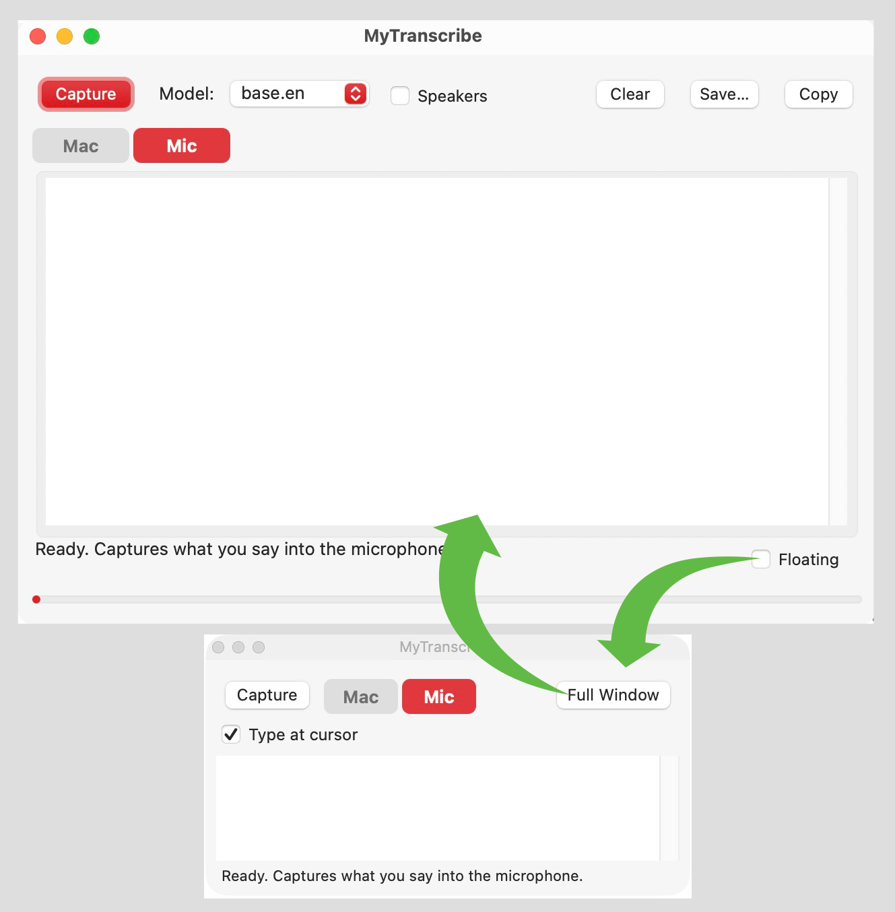

# MyTranscribe 2.10.1

A small macOS app that transcribes what your Mac is playing, or what you say into the microphone, using OpenAI Whisper on your own machine.



## Which one: MyTranscribe or Speak2Transcribe?

MyTranscribe has a sibling, [Speak2Transcribe](https://github.com/spurious-cox/speak2transcribe): the same icon and the same Mic / Mac, floating panel and Type at cursor, rebuilt as a native Mac App Store app.

| | MyTranscribe | Speak2Transcribe |
|---|---|---|
| Speech engine | OpenAI Whisper, bundled | Apple's on-device speech recognition |
| Written in | Python + PyObjC | Swift + SwiftUI |
| Install | Homebrew or disk image | Mac App Store (submitted; link to follow) |
| Size | about 1.2 GB | small; Apple's speech model downloads once |
| Speaker labels | Yes | No |
| Needs | macOS 14+, Apple silicon | macOS 26+, Apple silicon |
| Source | here, MIT | [its own repo](https://github.com/spurious-cox/speak2transcribe) |

Both are free, run entirely on your Mac, and type at the cursor the same way.

## Install

With [Homebrew](https://brew.sh):

```
brew install --cask spurious-cox/tap/mytranscribe
```

Or download the disk image from the [latest release](https://github.com/spurious-cox/MyTranscribe/releases/latest) and drag MyTranscribe to Applications.

## Features

- **Mac / Mic** — transcribe system audio (ScreenCaptureKit) or the microphone.
- **Capture** — text appears in chunks while it listens; click again to stop.
- **Pause / Resume** — hold transcribing without stopping the capture; greyed out unless a capture is running.
- **Chunk slider** — 10 to 30 seconds of audio per chunk (default 20). Longer is usually more accurate, shorter shows text sooner. Remembered between runs.
- **Speakers** — optional speaker labels.
- **Floating** — a small panel that stays in front of other apps and never takes focus from them.
- **Type at cursor** — types each chunk as keystrokes wherever the cursor is in the frontmost app. The clipboard is not used.
- **Spoken line breaks** — say "new line" or "new paragraph"; they are typed as Shift-Return, so chat boxes don't send.
- Filters common Whisper hallucinations and collapses repeated phrases.
- Clear, Save and Copy the transcript.
- Help ▸ MyTranscribe Help explains each control; hover over a control for a tip.

## Requirements

- macOS 14 or later, Apple silicon (arm64)

The app is self-contained (about 1.2 GB): Python, PyObjC, PyTorch, Whisper and the models are inside it. Nothing else needs to be installed, and nothing is downloaded.

## Building from source

Needs the python.org Python 3.12 and the two models in `models/` (Whisper `base.en.pt` and the SpeechBrain ECAPA speaker model in `ecapa/`). They are not in the repository: `base.en.pt` is what `whisper.load_model("base.en")` downloads, and the ECAPA model is [speechbrain/spkrec-ecapa-voxceleb](https://huggingface.co/speechbrain/spkrec-ecapa-voxceleb).

```
/Library/Frameworks/Python.framework/Versions/3.12/bin/python3 -m venv venv
./venv/bin/pip install "setuptools<81" wheel
./venv/bin/pip install --no-build-isolation -r requirements.txt
./build.sh
```

Replace `SIGN_ID` in `build.sh` with your own signing identity.

## Permissions

- **Screen & System Audio Recording** — for Mac audio
- **Microphone** — for Mic
- **Device Control and Data Access** (Accessibility) — for Type at cursor

## Issues

Report problems at https://github.com/spurious-cox/MyTranscribe/issues

## License

MIT — see [LICENSE](LICENSE).

## Automatic transcripts

Every capture is saved as it grows to `iCloud Drive/Transcripts/transcript_<date>_<time>.txt` (one file per capture). Save… is still there for saving elsewhere.
